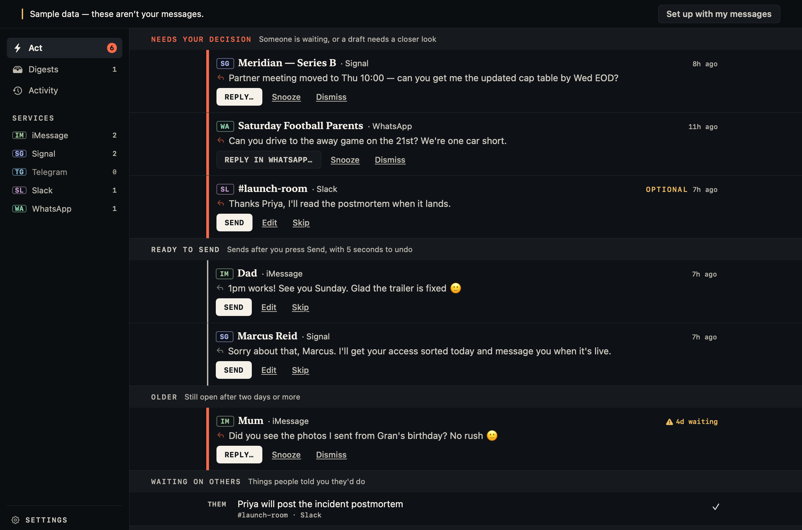
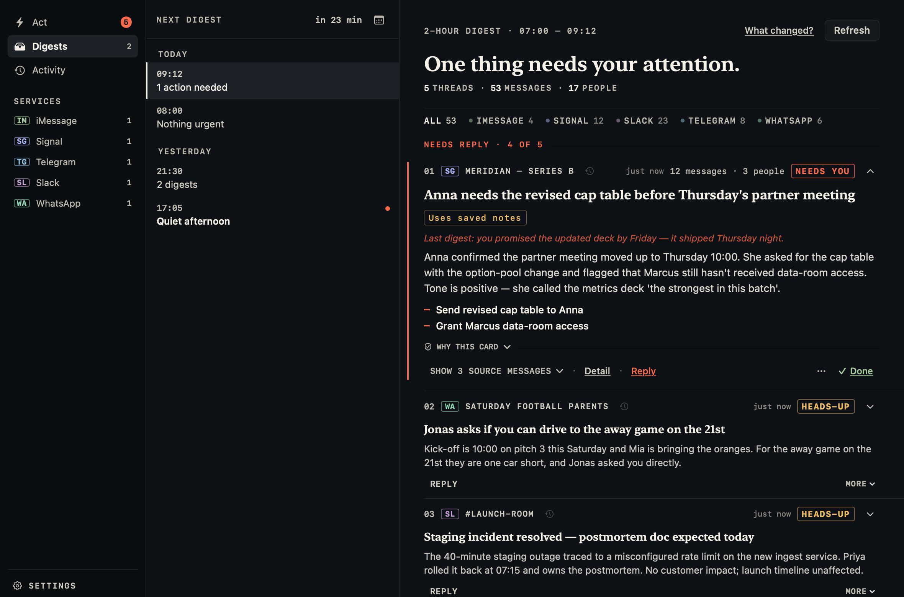
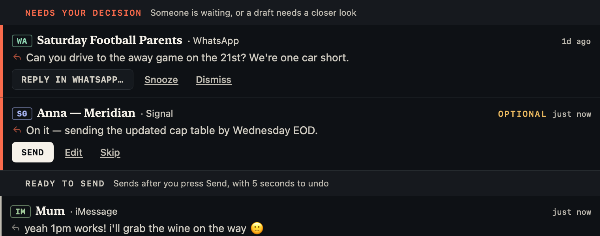
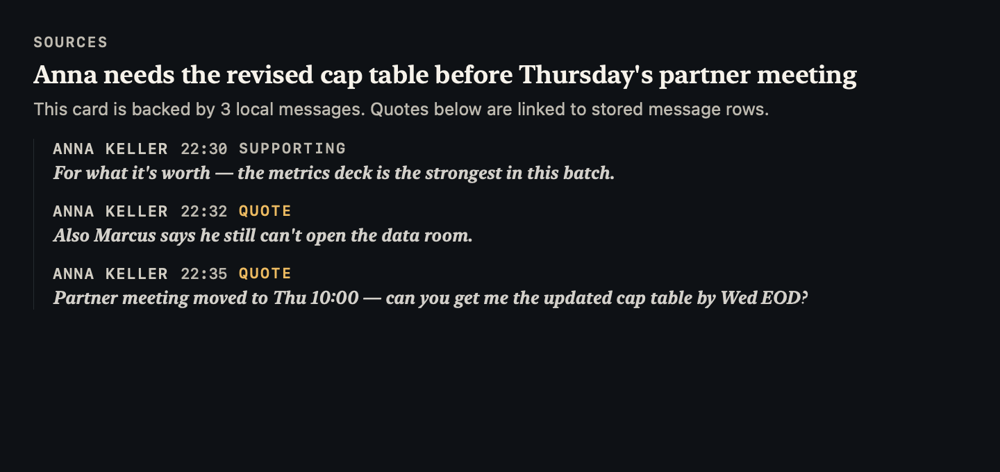
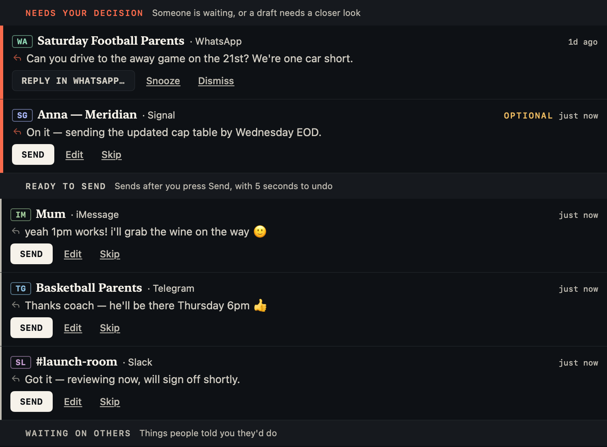
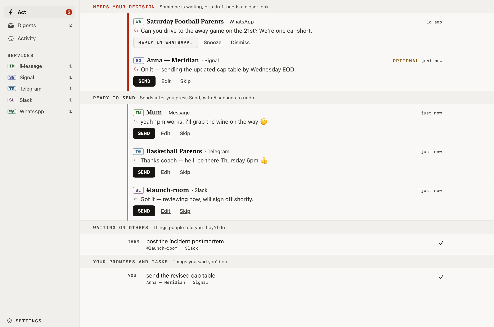

<div align="center">


# LLMessenger

**Read one digest instead of 200 messages. Send the replies it drafts, or don't.**

LLMessenger is a menu-bar app for macOS 14+. It reads your messengers on your Mac (iMessage, Signal, Telegram, Slack, and WhatsApp read-only), turns the noise into one digest, and tells you who is still waiting on you. It also drafts replies in your voice and puts them in a queue. You approve, edit or skip each one, and every send waits 5 seconds so you can Undo it.

Free and open source. Use a local model (Ollama, or Apple's on-device AI on macOS 26) and your messages never leave your Mac. Cloud AI is opt-in.

[](https://github.com/googlarz/LLMessenger/actions/workflows/ci.yml)
[](https://github.com/googlarz/LLMessenger/releases/latest)
[](LICENSE)
[](https://github.com/googlarz/LLMessenger/releases/latest)
[](project.yml)

[**Download**](https://github.com/googlarz/LLMessenger/releases/latest) · [At a glance](#at-a-glance) · [Quick start](#quick-start) · [The agent](#it-doesnt-just-tell-you--it-acts) · [How it works](#how-it-works) · [Privacy](#privacy) · [FAQ](#faq)



</div>

---

## At a glance

- **Who it's for:** people on a Mac who live in several chats and miss the few messages that matter.
- **Is it safe?** There is no LLMessenger server and no telemetry. Nothing is sent without you pressing Send, except an optional per-conversation auto-send that is off by default. Details in [Privacy](#privacy) and [`PRIVACY.md`](PRIVACY.md).
- **Try it:** first launch starts with sample messages. You don't need to grant any access or add an API key to look around. See [Quick start](#quick-start).
- **Optional MCP server:** `LLMessenger --mcp` lets Claude, Cursor or another MCP client read owed replies and search your messages locally. Off by default. Replies an agent proposes wait in your queue.
- **Limits, up front:**
  - macOS 14+ only.
  - The app is **not signed or notarized**. First launch needs right-click → **Open**.
  - iMessage and WhatsApp need **Full Disk Access**, because the app reads their local databases.
  - WhatsApp is **read-only**. You reply in WhatsApp itself.
  - No Homebrew cask. Install from the GitHub release or build from source.

## Quick start

1. **[Download the latest release](https://github.com/googlarz/LLMessenger/releases/latest)**, unzip it, move it to Applications.
2. **First launch:** right-click the app → **Open** → **Open**. (Or System Settings → Privacy & Security → **Open Anyway**.) This is needed because the build is unsigned.
3. **Look around first.** Onboarding starts with sample messages. Nothing is sent while you're in the sample, and you can wipe it before connecting real services.
4. **Connect a service when you're ready.** For iMessage, grant Full Disk Access when prompted. The screen detects the grant live, no restart needed. Signal, Telegram, Slack and WhatsApp are added in Settings → Services.
5. **Pick your AI** ([options below](#choose-your-ai)), then clear your first digest.

| 1. Read the digest | 2. Clear the Act queue | 3. Inspect sources |
|---|---|---|
|  |  |  |

<details>
<summary><strong>Build from source instead</strong></summary>

```bash
git clone https://github.com/googlarz/LLMessenger
cd LLMessenger
brew install xcodegen
xcodegen generate
open LLMessenger.xcodeproj   # ⌘R in Xcode 16+
```

CI runs security checks, the full test suite, static analysis, and an unsigned universal archive on every push. The [release workflow](.github/workflows/release.yml) repeats those gates for each tag, verifies the app bundle, and publishes SHA-256 checksums for the packaged app and dSYMs.

</details>

---

## Why

You are in five group chats, two Slack workspaces, and a family iMessage thread. Most of those messages don't need you. A few really do — and they're buried.

Messaging apps answer this with more notifications. LLMessenger goes the other way:

- Routine chatter is held back silently.
- You get one notification when someone needs your reply.
- Everything else lands in one digest you can clear and leave.

Here is what a digest card looks like:

> **iMessage** — *Dad confirmed Sunday lunch, asks if 1pm works* · `NEEDS YOU`<br>
> Two messages, one direct question, source-backed.<br>
> **NEXT** → Confirm whether 1pm works.

> **Slack** — *#launch-room resolved the staging incident* · `HEADS-UP`<br>
> The outage was staging-only, postmortem due today, no customer impact.<br>
> **NEXT** → Review Priya's postmortem.

Every card explains why it is there, which local source messages back it, whether prior context affected it, and what privacy posture applies. Click any card to inspect sources, ask follow-up questions, teach the app "more like this" or "quiet this", or have the AI draft a response you review before sending.


## It doesn't just tell you — it acts

An agent runs in the background and prepares the work. It drafts each reply in your voice for that conversation, lines up follow-ups and RSVPs, and ranks them into one queue: **Needs your decision → Ready to send → Older → Waiting on others.** Each row shows who, what, and why now. **Send**, **Edit**, or **Skip**.


- **One Reply window.** Every Reply button opens the same window with the recipient and service shown. Write it yourself or press **Draft with AI**. It sends exactly the text you see, and every send waits 5 seconds so you can **Undo** it. The Ask panel only answers questions about your messages. It never sends.
- **Auto-send for boring lanes (optional, off by default).** You can turn on auto-send for one conversation and one low-risk action, like "auto-acknowledge from my team" or "auto-RSVP". It only does safe templated replies, never to a new recipient, never with a link or money. Every auto-send waits 30 seconds with an **Undo** and lands in an audit log. A message can't trigger or grant this. Only you can set it.
- **Commitments.** It tracks promises both ways — yours (*"I'll send the photos"*) and theirs (*"review by Friday"*) — and chases them when they're due.

## Never drop someone who matters

The firewall handles what comes in. The queue handles who is waiting on you. **Needs your decision** and **Ready to send** are ranked by who counts, so a question from Mum or your kid's coach doesn't get buried under work chatter. **Waiting on others** is the reverse: what you're still owed.

Digest cards separate **urgency** from **actionability**: a low-stakes family question can still be marked as needing a reply without being treated as urgent.



It learns who matters from your own behavior, or you can just tell it: *"this is my son's basketball team — the coach posts about training and games, flag those, ignore the rest."* That per-conversation **context** then sharpens every triage decision and every digest. Conversations you mark private are never sent to a cloud model.

<details>
<summary>Light mode, too (follows your system, or set it manually)</summary>



</details>

## Choose your AI

| Backend | Setup | Cost | Privacy |
|---|---|---|---|
| **On-Device** (Apple Intelligence) | None — auto-selected | Free | Nothing leaves your Mac · macOS 26+ |
| **Ollama** | `brew install ollama && ollama pull llama3.1` | Free | Nothing leaves your Mac · macOS 14+ |
| **Anthropic Claude** | API key | Pay per use | Opt-in cloud — best digest quality |
| **OpenAI** | API key | Pay per use | Opt-in cloud |

Cloud backends are strictly opt-in. **Local-only mode** (Settings → AI & Privacy → Privacy) is a single toggle that keeps message content away from cloud AI providers and blocks AI apps connected over MCP from reading anything.

## What it does

<details>
<summary>Full feature list</summary>

**Attention protection**
- **Notification firewall** (on by default) — routine digests generate silently; only `NEEDS YOU` breaks through. Held-back count surfaces in your next digest.
- **Owed Replies** — a running, ranked list of people still waiting on your reply, so nothing important slips. Reply in place, snooze, or dismiss.
- **Morning Digest** — one scheduled daily digest with everything the firewall held back, ordered by who matters to you.
- **Notification Center widget** — latest headline + priority counts at a glance (macOS 14+).

**Acts for you**
- **Action queue** — the agent drafts replies (in your per-conversation voice), follow-ups, and RSVPs and ranks them for one-tap Send / Edit / Skip. ⌘-click several compatible sends to send them together.
- **Scoped delegation** — opt a single conversation into auto-sending a single low-risk action type. Off by default, 30-second Undo, audit log, global kill switch; never triggerable by message content.
- **One Reply window** — recipient and service always shown; write the reply or Draft with AI, edit it, and every send waits 5 seconds with an Undo. The Ask panel only answers questions and never sends.
- **Commitments ledger** — promises tracked both ways and chased when due.
- **Calendar holds** — proposes local calendar events and RSVPs from scheduling threads (EventKit, on your Mac).

**Understands who matters**
- **Per-conversation context** — tell it (or let it learn) who's a key sender, what's important, and what's noise; it sharpens every triage and digest. Teach it in plain language or accept its suggestions.
- **Learned suggestions** — "you always reply to Coach fast — prioritize him here?" from your own behavior, never nagging.
- **Per-conversation privacy** — mark a conversation local-only (never touches the cloud) or never-draft. The relationship model stays entirely on your Mac.

**Digests**
- Unified inbox: iMessage, Signal, Telegram, Slack (multi-workspace), and WhatsApp (read-only).
- **MCP server mode** (opt-in) — let Claude, Cursor, or any MCP client ask "what do I owe people?" or search your messages locally. Off by default; Local-only conversations are never exposed; replies an agent proposes wait in your queue for approval.
- Structured cards: headline, prose summary, action items, key quotes, priority, reply-needed state, and the reason it matters.
- Actionability is explicit: `needsReply`, reason, and grounding chips separate "urgent" from "you should answer this."
- Card-level trust: each expanded card shows reason, evidence count, memory/context use, and privacy posture.
- One-click teaching: mark a conversation VIP, quiet it, or correct priority from the card itself.
- One conversation can produce multiple cards when a thread contains distinct asks, decisions, and FYIs.
- **Source-grounded** — every card cites exact message IDs; quotes are validated against real messages.
- Conversation memory: rolling per-conversation summaries and unresolved actions carry across digest cycles, and older digests compress into episodic context.
- Your own replies are captured as context, so the AI knows when you've already responded.

**Composing**
- Ask questions about any conversation in plain language.
- Quick-reply chips matched to your writing style — they populate the composer, never auto-send.
- `@` mention picker — pick a person and the Reply composer opens addressed to them, with their service shown; nothing is sent until you press Send.
- AI reply drafts you review, edit, send, or discard.

</details>

## How it works

<details>
<summary>Architecture diagram</summary>

```
  Adapters ──► iMessage   ~/Library/Messages/chat.db (FSEvents, real-time)
               Signal     local signal-mcp daemon         │
               Telegram   bundled adapter binary          │  poll (30s)
               Slack      Web API, multi-workspace        │
               WhatsApp   WhatsApp Desktop's local store (read-only)
                                        │                 │
                                        ▼                 ▼
                          SQLite (GRDB) — everything stays local
                                        │
                  ┌─────────────────────┴─────────────────────┐
                  ▼                                            ▼
        TriageEngine (real-time)                    BriefEngine (summary)
        rules + your context decide                 source-grounded prompts,
        notify · hold · stay-local                  rolling + episodic memory
                  │                                            │
                  ▼                                            ▼
        🔔 notify only if needed                      Brief stored → digest
                  │                                            │
                  └──────────────┬─────────────────────────────┘
                                 ▼
                    Owed Replies + Commitments
                                 │
                                 ▼
                      AgentEngine — drafts actions in your voice
                                 │
                  ┌──────────────┴───────────────────┐
                  ▼                                   ▼
        Action Queue → you press Send           AgentDelegation.decide()
        (Edit / Skip / one tap)               the ONLY gate that may auto-send:
                                              user-delegated · low-risk · known
                                              recipient · no links/money → 30s Undo
```

</details>

Per-conversation **context** (who's a key sender, what's important, what's noise) feeds the TriageEngine, the summarizer, and the agent's drafting — and a conversation marked local-only never reaches a cloud model. **`AgentDelegation.decide()` is the single chokepoint for any automatic send**; it reads only structured action fields and your settings — never message content — so a crafted message can't make the app send anything. Each service is summarized in parallel; one adapter failing never drops the rest. The adapter contract is a 6-method protocol ([`MessengerAdapter.swift`](LLMessenger/Core/Adapters/MessengerAdapter.swift)) — also frozen as a [subprocess plugin API](docs/PLUGIN-API.md), so new services are a contribution (or a plugin) away.

## Privacy

This is the entire trust model — see [`PRIVACY.md`](PRIVACY.md) for the full data-flow story:

- **There is no LLMessenger server.** Nothing to breach, no developer who can read your messages, no account to create.
- **All data lives in** `~/Library/Application Support/LLMessenger/`. Delete the folder, and it's gone.
- **On-Device or Ollama = zero egress.** With a local backend and no Slack, no message content ever leaves your machine.
- **Network audit log** (Settings → AI & Privacy → Privacy) shows every cloud HTTPS call live — provider, endpoint, status, bytes. Never message content.
- **Pre-send redaction** (opt-in) strips credit cards, SSNs, IBANs, and emails before anything reaches a cloud LLM.
- **Keys in the Keychain.** API keys and Slack tokens are never written to plain files.
- **No telemetry or analytics, and nothing is sent to the developer.** The one thing the app looks up on its own is a new version on GitHub, when it starts and at most once a day. The request carries no message content or account details, and you can switch it off in Settings → AI & Privacy → Privacy → Updates.

Don't trust the README? The [reproducible release workflow](.github/workflows/release.yml) lets anyone rebuild the packaged app from source on a clean GitHub runner and compare SHA-256 hashes.

## FAQ

<details>
<summary><strong>Does the agent send messages on its own? Will it ever auto-send?</strong></summary>

By default, **no**. It only prepares actions, and you press Send. Quick replies and AI drafts wait for your tap too. The one exception is opt-in: you can delegate a single low-risk action type (acknowledgements, RSVPs) for a single conversation, and then it auto-sends those — but with a 30-second Undo, an audit log, and a global kill switch. It is off until you turn it on, never applies to a brand-new recipient or anything containing a link or money, and **cannot be enabled or triggered by the content of a message** — delegation is something only you set, and the decision that authorizes a send reads only your settings, never message text. Everything else always waits for your tap.
</details>

<details>
<summary><strong>Can I try it without connecting accounts?</strong></summary>

Yes. First launch starts with sample messages (onboarding button: **See it with sample messages**). They are synthetic conversations seeded into the local database, shown in the same command center, Act queue and source viewer as the real app. No account, message permission, or API key is needed, and nothing is sent in the sample.
</details>

<details>
<summary><strong>Are the screenshots real user data?</strong></summary>

No. README screenshots are generated from `DesignSnapshotTests` and `DemoSeeder` synthetic fixtures: investor thread, launch room, family plan, and low-signal group. They do not read your Messages database or any personal account.
</details>

<details>
<summary><strong>Does this send my messages to OpenAI / Anthropic?</strong></summary>

Only if you explicitly choose a cloud backend. The default path (On-Device on macOS 26, Ollama otherwise) processes everything locally. Local-only mode stops message content going to cloud AI providers and Slack with one toggle, and the network audit log lets you verify it live. A conversation marked local-only is never sent to a cloud model — including for the agent's reasoning.
</details>

<details>
<summary><strong>Does it build a profile of my relationships?</strong></summary>

It builds a *local* model of what matters to you — per-conversation context and who you owe replies to — and it never leaves your Mac. There's no server copy and no sync. It's scoped to one conversation at a time (no cross-chat identity graph), fully visible in the context editor, and deletable: clear a conversation's context, or delete the data folder, and it's gone. You can also mark any conversation local-only so it's never sent to a cloud model. See [`PRIVACY.md`](PRIVACY.md).
</details>

<details>
<summary><strong>How does Owed Replies decide I owe someone?</strong></summary>

A conversation shows up when its latest inbound message was a question or got flagged as needing a reply, and you haven't sent anything since — looking back about two weeks. It's deliberately conservative (it would rather miss one than nag you about a thread you already handled on your phone), and a reply sent on *any* device clears it. Ranking is by your context priority, so Mum outranks a muted group.
</details>

<details>
<summary><strong>Why does it need Full Disk Access?</strong></summary>

iMessage history lives in `~/Library/Messages/chat.db`, which macOS protects behind Full Disk Access. LLMessenger reads that database directly, because there is no iMessage API. WhatsApp Desktop's local history needs the same permission. You can see exactly what's done with it in [`iMessageAdapter.swift`](LLMessenger/Core/Adapters/iMessageAdapter.swift).
</details>

<details>
<summary><strong>What about WhatsApp?</strong></summary>

Supported read-only since v2.4.0. LLMessenger reads WhatsApp Desktop's local history on your Mac (the same way it reads iMessage), so WhatsApp chats show up in digests and owed replies. There is no local send API, so you reply in WhatsApp itself — LLMessenger drafts the text and opens the chat. It's off by default; enable it in Settings → Services. Requires WhatsApp Desktop installed and signed in, and Full Disk Access for LLMessenger (System Settings → Privacy & Security → Full Disk Access); the WhatsApp card in Settings tells you which of these is missing. "Open" jumps straight to the chat only for one-to-one chats; for groups it just opens WhatsApp, and you pick the group yourself.
</details>

<details>
<summary><strong>How accurate are the summaries?</strong></summary>

Every card must cite real message IDs and quotes are validated against the actual messages — fabricated quotes are rejected before a digest is stored. Quality depends on the backend; Claude produces the strongest digests, on-device models the most private ones.
</details>

<details>
<summary><strong>Why is the app unsigned?</strong></summary>

Code signing requires a paid Apple Developer account, and this is a free community project. The reproducible-build workflow is the alternative trust path: verify the binary against the source yourself. Want a notarized build? `make notarize` with your own Developer ID — see [`docs/NOTARIZATION.md`](docs/NOTARIZATION.md).
</details>

## Requirements

- macOS 14 Sonoma or later. macOS only. (On-Device AI needs macOS 26+ with Apple Intelligence.)
- An AI backend: Ollama, On-Device AI, or an Anthropic/OpenAI key
- **iMessage** — needs Full Disk Access
- **Signal** *(optional)* — [signal-mcp](https://github.com/googlarz/signal-mcp) running locally
- **Telegram** *(optional)* — bundled adapter, interactive sign-in from Settings
- **Slack** *(optional)* — your own Slack app's user token, multi-workspace supported
- **WhatsApp** *(optional, read-only)* — WhatsApp Desktop installed and signed in, plus Full Disk Access

## Contributing

PRs and issues welcome — this project is free and stays free.

The highest-impact contribution is a **new service adapter**: implement the 6-method [`MessengerAdapter`](LLMessenger/Core/Adapters/MessengerAdapter.swift) protocol and your service plugs into polling, digests, the firewall, and the composer automatically. [`SignalCLIAdapter.swift`](LLMessenger/Core/Adapters/SignalCLIAdapter.swift) is a good reference implementation.

```bash
xcodegen generate                      # project.yml is the source of truth
xcodebuild -scheme LLMessenger test    # keep them green
```

## Roadmap

- [ ] Cross-conversation people memory (link who's who across chats)
- [ ] Email adapter (IMAP read-only — Proton Bridge, Gmail, iCloud)

<details>
<summary>Shipped (v1.4 – v2.5.0)</summary>

**v2.5.0** — easier to reply, easier to start:
- ✅ **One Reply window** — shows who you're writing to and on which service, and sends exactly the text you see; every send still waits 5 seconds for Undo
- ✅ The Ask panel only answers questions and can no longer send anything
- ✅ A failed send stays in the Act queue with Try again, including when the service isn't connected
- ✅ **First launch starts with sample messages** — try the whole app before granting any access; nothing is sent in the sample
- ✅ Settings: service switches save right away, unsaved fields survive closing the window, the WhatsApp card says what is missing
- ✅ MCP: confirmation before turning on, setup steps for Claude and Cursor, and a "last agent request" line
- ✅ MCP privacy fixes: digests drawing on Local-only conversations are withheld; an outside agent can't change a reply you already reviewed
- ✅ Plainer labels in digests and the Act queue ("3 messages · 1 person", "Uses saved notes", "Optional")
- ✅ The sample now includes a WhatsApp chat
- ✅ Better VoiceOver announcements, visible keyboard focus, larger small text, stronger contrast
- ✅ No more microphone or speech recognition permission

**v2.4.0** — WhatsApp and MCP:
- ✅ **WhatsApp (read-only)** — reads WhatsApp Desktop's local history so WhatsApp chats appear in digests and owed replies; you reply in WhatsApp, with the draft ready to copy
- ✅ **MCP server mode (opt-in)** — `LLMessenger --mcp` lets Claude, Cursor, or any MCP client read owed replies, the latest digest, and search messages locally; proposed replies wait in your queue, labelled as coming from an external agent
- ✅ Local-only conversations are never exposed over MCP, and are left out of digests while MCP is on
- ✅ A database that fails to open is no longer silently replaced — the app asks before moving it aside

**v2.3.3** — fixes from an adversarial re-review:
- ✅ Refresh no longer clears a question you were mid-typing — only navigating to a different digest yourself clears the composer
- ✅ Fixed an abandoned @-mention target silently redirecting a reply to the wrong person
- ✅ A priority rule that suppresses every message now asks for confirmation before saving
- ✅ Closed a narrow window where auto-send could be saved without the confirmation dialog being shown
- ✅ Fixed the v2.3.2 binary reporting itself as v2.3.1 in the About tab, and still saying MIT instead of Apache 2.0
- ✅ Removed the Homebrew install instructions — the tap has no LLMessenger cask yet

**v2.3.2** — bug-hunt hardening pass:
- ✅ Fixed 15 bugs found in a manual audit: state leaking across digest navigation, wrong row expanding after a reload, a settings sub-tab silently resetting, a rule that could never be saved, and more
- ✅ Fixed a flaky accessibility-audit test and a latent build-analyzer warning found during a full pre-release verification pass
- ✅ 6 new regression tests added; full suite at 723 tests, zero analyzer warnings

**v2.3.1** — Activity becomes a trend, not just today:
- ✅ Activity now covers the last 14 days instead of just today — a real trail of when things needed you
- ✅ Grouped by day: today stays open, older days collapse to a header with a "N needed you" count and expand on tap
- ✅ Quiet days show no badge — the count only appears when something actually needed you
- ✅ Fixed the "old ledger" look in Activity and per-conversation history: entries separate by whitespace with one clear headline per row, not a hairline after every line

**v2.3.0** — the Mac-native redesign:
- ✅ **Navigation rebuilt** — content-free sidebar (Act / Digests / Activity) drives the whole window; Act and Activity go full-width, Digests pairs the archive with the open digest
- ✅ **Native title-bar toolbar** + a real macOS menu bar — search, refresh, service status, digest back/forward, and every command with a shortcut (previously missing entirely)
- ✅ **Progressive digest cards** — default view is headline + two lines + one action; only the top card opens expanded
- ✅ **Ask panel** — the AI conversation is opt-in from the toolbar, closed by default, so reading never looks like composing
- ✅ **Act is one ranked queue** — Needs your decision / Ready to send / Waiting on others / Later, with ⌘-click batch approval
- ✅ Settings consolidated 7 panes → 5; Reduce Motion and Increase Contrast honored app-wide; no text below 10pt
- ✅ Feedback scaled to significance — toolbar spinner for routine refresh, floating toasts that don't displace content

**v2.2.5 – v2.2.7** — internal hardening:
- ✅ Act tab leads with what needs you; retrospective stats moved to Activity; first-week guide dismisses for good
- ✅ Fixed several runtime crash-risk force-unwraps in the message adapters and poll pipeline
- ✅ Brief JSON cached instead of re-decoded on every render; menu bar rebuilds coalesced to one per refresh
- ✅ In-app "What's new" section in the About tab

**v2.2.4** — trust, demo, and product-love pass:
- ✅ Demo-first onboarding lets new users explore the command center before connecting real accounts
- ✅ Empty-state CTA opens the sample command center instead of leaving users at setup-only dead air
- ✅ Card context popovers now include conversation-level privacy controls: normal, local-only, and never draft
- ✅ Source-evidence screenshot and README FAQ make it clear demos use synthetic data, not private inbox content
- ✅ README conversion flow now shows demo, action, and source-proof screenshots together
- ✅ Product-health and first-week surfaces make progress, trust, and habit loops visible inside the app

**v2.2.3** — brief quality + actionability:
- ✅ Explicit `needsReply`, `reason`, and `grounding` fields on digest cards
- ✅ Reply-needed is separate from urgency: low-priority questions can still surface without becoming high priority
- ✅ Reason and grounding chips explain why a card matters and whether it is direct, contextual, or inferred
- ✅ One conversation can produce multiple cards when it contains distinct asks, decisions, or FYIs
- ✅ Priority rules now transform the visible stored digest JSON, so rule outcomes match what the user sees
- ✅ Product-love pass: clearer first-run demo path, card-level trust explanation, one-click VIP/quiet teaching, local product-health surfaces, and synthetic README screenshots

**v2.2.2** — action-first UX + large-inbox safety:
- ✅ Unified Act feed with keyboard navigation, staged sends, undo, editable drafts, and source-aware action flow
- ✅ Large-inbox bounded loading, targeted context/card fetches, and "Load older digests"
- ✅ Local-only mode stops cloud-only adapters immediately; Slack 429 retry handling is capped
- ✅ Stronger prompt, source, and reply-draft guardrails for multi-conversation digests

**v2.2.1** — polish + accessibility pass:
- ✅ **"Digest" rename** — all user-visible copy now says "digest" consistently (was mixed "brief" / "digest")
- ✅ **Always-visible delegation kill switch** — a PAUSE/RESUME banner appears in the Desk sidebar whenever any conversation has auto-send configured; no more hunting through the menu bar
- ✅ **Confirmation dialogs** on destructive actions: delete rule, remove Slack workspace
- ✅ **Friendly error messages** — all 20+ error assignment sites now route through `friendly()`, mapping common failures (network, Ollama, config) to plain-English one-liners
- ✅ **Accessibility**: labels on all unlabelled settings toggles and icon buttons; expand/collapse hints on digest entry rows and triage event rows; triage event rows declared as buttons for VoiceOver

**v2.2 "Polish"** — quality-of-life and trust signals:
- ✅ Plain-language onboarding for non-technical users (R1/R7)
- ✅ Demo morphs into real account setup instead of wiping (R2)
- ✅ Conservative/additive framing for delegation throughout onboarding and context editor
- ✅ Card recency timestamps + "why NEEDS YOU" micro-line on urgent inbox cards
- ✅ Action sweep-off animation, haptic feedback on Approve/Skip, friendly error messages
- ✅ Cmd-F focuses search, local-only AI banner, reset-prompt confirmation
- ✅ Visible "sent on your behalf" audit log in Activity tab
- ✅ Trust/safety copy visible on first run (local-first promise)
- ✅ WCAG-AA contrast pass; reduce-motion support
- ✅ Persistent To-Do strip + "Maybe" bucket in Desk sidebar

**v2.1 "Act"** — the app stops being a reader and becomes an agent:
- ✅ **Action queue** — the agent drafts replies/follow-ups/RSVPs in your voice for one-tap Approve / Edit / Skip
- ✅ **Scoped delegation** — opt-in per-conversation auto-send for low-risk actions, with 30s Undo + audit log + kill switch (never triggerable by message content)
- ✅ **One Reply composer** — recipient and service shown, Draft with AI, 5-second Undo; the Ask panel answers questions and never sends
- ✅ **Commitments ledger** — two-way promise tracking, chased when due
- ✅ **Calendar holds + RSVPs** from scheduling threads (local EventKit)

**v2.0 "Understand"** — the app learns who matters and protects your relationships:
- ✅ **Owed Replies** — the people waiting on you, ranked by who counts (attention-debt surface)
- ✅ Per-conversation **Context** — tell it (or it learns) what's important and who's signal; drives triage + summaries
- ✅ Learned context suggestions — "prioritize Coach Mike here?" from your own reply behavior
- ✅ Learning loop + per-conversation privacy (`local_only` never touches the cloud; `never_draft`)
- ✅ Per-conversation glossary · context-aware digest ordering

**v1.4 – v1.7:**
- ✅ Notification firewall · Morning Digest · Notification Center widget
- ✅ On-Device AI via Apple Intelligence (macOS 26+)
- ✅ iMessage-first 60-second onboarding
- ✅ Quick Reply — style-matched suggestions (never auto-send)
- ✅ Slack adapter (multi-workspace) · `@` mention picker
- ✅ Local-only mode · network audit log · pre-send redaction
- ✅ Security hardening (prompt-injection defenses, URL validation)
- ✅ Search, pinning, date filters, Demo Mode, Wire Desk redesign
- ✅ Reproducible release builds
- ✅ Real-time notification firewall (FSEvents + 30s poll fallback)
- ✅ Priority rules v2 — quiet hours, behavior-based suggestions
- ✅ "The Desk" — Now / Today / Archive with light mode
- ✅ Adapter plugin API v1 — PLUGIN-API.md + echo reference adapter

</details>

## License

[Apache 2.0](LICENSE) — free for everyone, forever.
